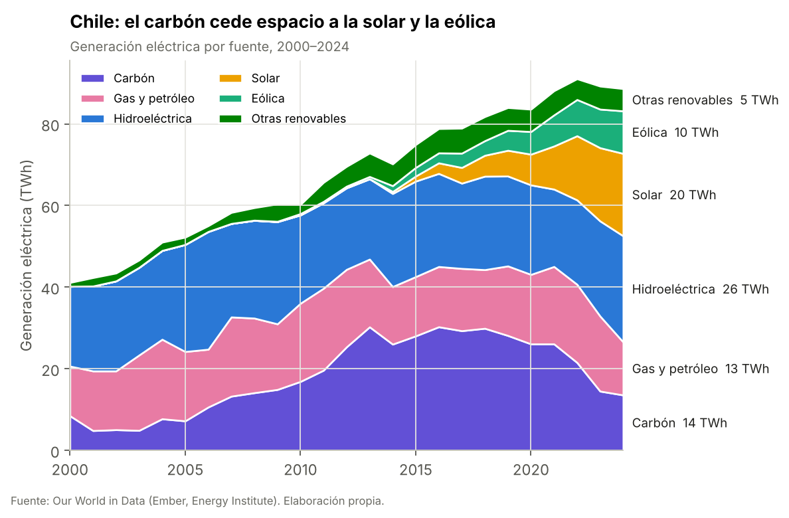
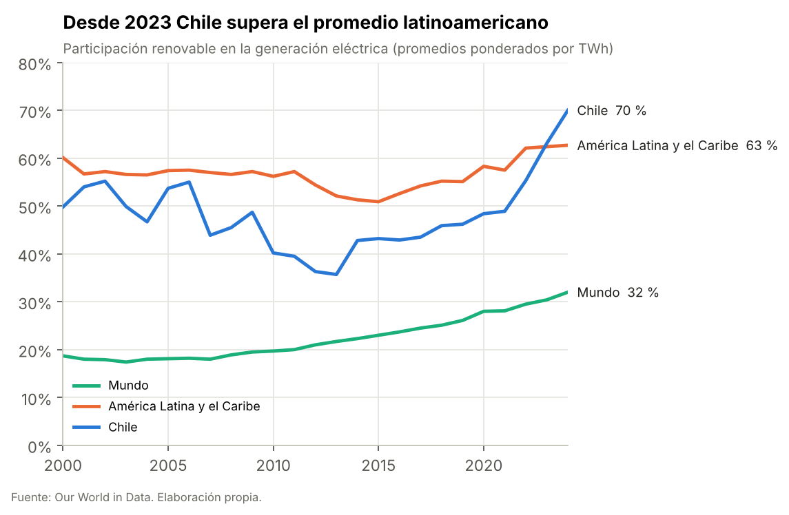
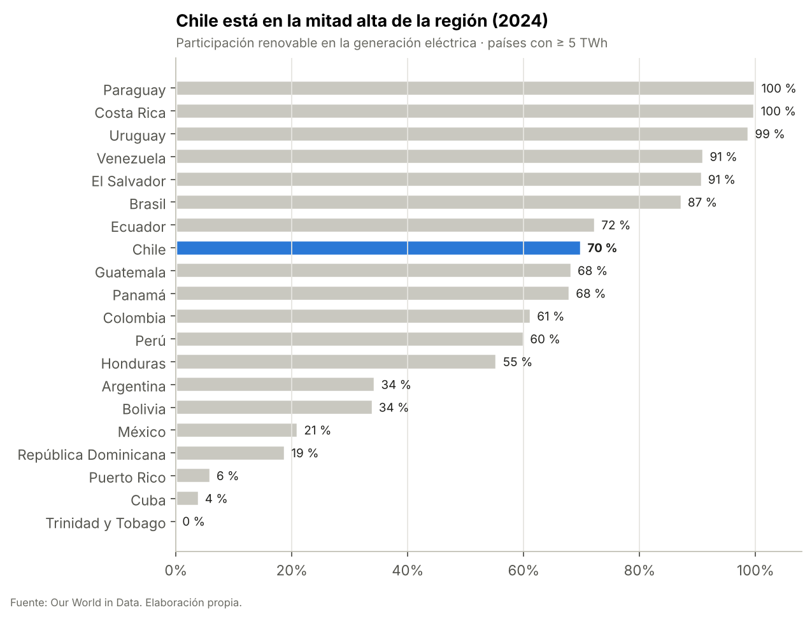
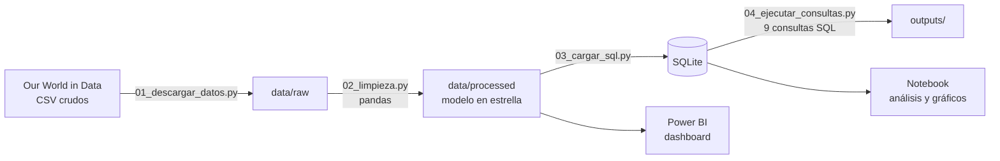
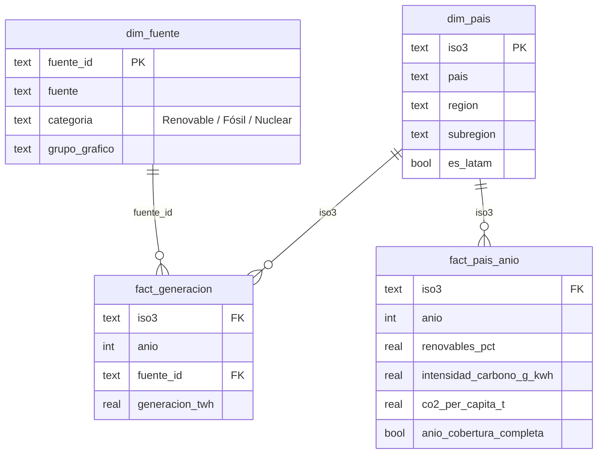
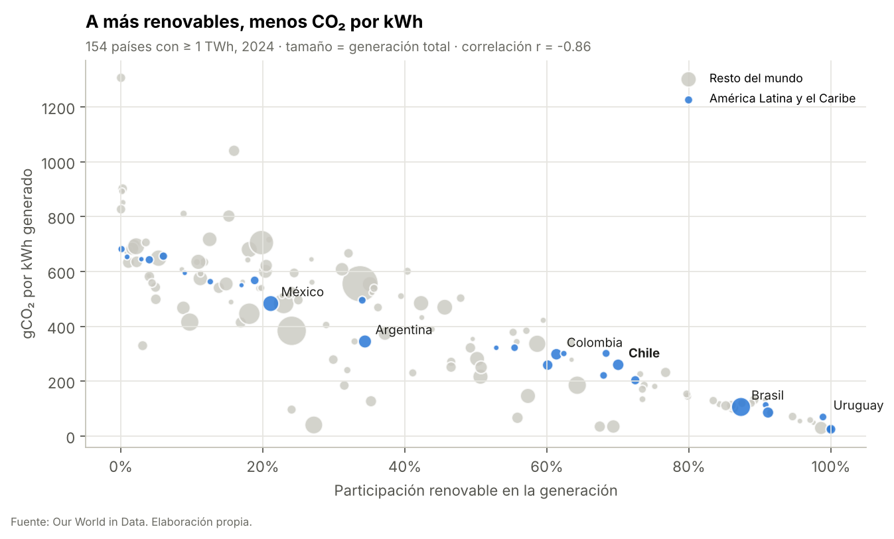

# ⚡ Transición energética en Chile y América Latina

**Análisis de datos de punta a punta:** limpieza con **pandas** → modelo en estrella en **SQL** → consultas de negocio → dashboard en **Power BI**.

¿Qué tan rápido está cambiando la matriz eléctrica de Chile y cómo se compara con el resto de América Latina y el mundo? Este proyecto lo responde con 25 años de datos públicos (2000–2025) de 214 países.



---

## Hallazgos principales

| # | Hallazgo | Evidencia |
|---|---|---|
| 1 | **Chile pasó de 43 % a 70 % de generación renovable entre 2015 y 2024**, el mayor salto en solar + eólica de la región (+30 puntos porcentuales). | [`sql/03`](sql/03_crecimiento_solar_eolica.sql) |
| 2 | **La participación del carbón bajó de 37 % a 15 %** en el mismo periodo. Es una de las 10 mayores reducciones del mundo entre países que generan al menos 10 TWh. | [`sql/06`](sql/06_salida_del_carbon.sql) |
| 3 | **Desde 2023 Chile supera el promedio latinoamericano** (63 % en 2024, ponderado por generación), aunque ese promedio ya era alto por la hidroelectricidad. | [`sql/04`](sql/04_chile_vs_latam_vs_mundo.sql) |
| 4 | **Chile lleva 3 años seguidos sobre el 50 % renovable (desde 2022).** Antes solo lo había logrado de forma intermitente. | [`sql/08`](sql/08_anio_supera_50_renovable.sql) |
| 5 | **Más renovables, electricidad más limpia:** los países con 80–100 % renovable emiten unas 7 veces menos CO₂ por kWh que los que están bajo 20 % (correlación r = −0,86). | [`sql/07`](sql/07_renovables_vs_intensidad_carbono.sql) |
| 6 | **2025 es preliminar** (solo 90 países informados). La baja de Chile a 66 % coincide con una menor generación hidroeléctrica ese año. | [`sql/05`](sql/05_variacion_anual_chile.sql) |

<p>
  
  
</p>

---

## Dashboard en Power BI

<!-- Reemplaza estas líneas por tus capturas cuando termines el dashboard:


-->

El archivo `powerbi/transicion_energetica.pbix` usa los CSV de `data/processed/` con un modelo en estrella y medidas DAX:

- **Página 1 · Chile:** indicadores (% renovable, cambio vs 2015, % carbón, brecha vs LatAm), evolución del mix por fuente y comparación con LatAm y el mundo.
- **Página 2 · LatAm:** ranking por % renovable, dispersión de renovables vs intensidad de carbono y tabla comparativa.
- **Página de notas:** fuentes, definiciones y advertencias metodológicas.

Las medidas están en [`powerbi/medidas.dax`](powerbi/medidas.dax) y la construcción paso a paso en [`powerbi/GUIA_POWER_BI.md`](powerbi/GUIA_POWER_BI.md).

---

## Flujo del proyecto



### Modelo de datos



---

## Qué muestra cada parte

### 1. Limpieza con pandas — [`src/02_limpieza.py`](src/02_limpieza.py)

Cada decisión queda registrada en [`outputs/reporte_calidad.md`](outputs/reporte_calidad.md):

- **Se separan países de agregados.** OWID mezcla países con regiones ("World", "Europe", "High-income countries"…). Se excluyen 94 entidades para no contar dos veces.
- **Se imputan nulos con criterio.** Una fuente sin dato se reemplaza por 0 solo cuando las demás fuentes ya suman el total del país (tolerancia de ±0,5 %). Si no suman, la fila se marca y no se imputa.
- **Se recalculan y validan las participaciones.** Los porcentajes se calculan desde los TWh y se comparan con los que publica OWID (diferencia máxima: 0,00 pp).
- **Se transforma la tabla a formato largo** (*melt*): de 9 columnas por fuente a filas país × año × fuente, el formato que necesitan SQL y Power BI.
- **Se enriquece la dimensión país** con región y subregión (`country_converter`) y nombres en español (`babel`).
- **Se valida la unión con CO2** con `validate="one_to_one"`: 96,6 % de las filas tienen dato de emisiones.
- **Se marcan los años con cobertura parcial.** En 2025 solo hay 90 países, así que los rankings usan el último año completo (2024).

### 2. SQL — [`sql/`](sql/)

Son nueve preguntas de análisis. Los resultados están en [`outputs/resultados_consultas.md`](outputs/resultados_consultas.md).

| Consulta | Pregunta | Técnicas |
|---|---|---|
| `01` | Evolución de la matriz eléctrica de Chile | `JOIN`, pivot con `CASE` |
| `02` | Ranking latinoamericano por % renovable | CTE, `RANK()`, self-join entre años |
| `03` | Mayor crecimiento solar + eólica 2015 → 2024 | CTE, comparación de periodos, `NULLIF` |
| `04` | Chile vs. LatAm vs. mundo | `UNION ALL`, promedios ponderados |
| `05` | Variación anual de la solar en Chile | `LAG()` |
| `06` | Países que más redujeron el carbón | self-join, filtros de relevancia |
| `07` | Renovables vs. intensidad de carbono | segmentación con `CASE`, `GROUP_CONCAT` |
| `08` | Desde qué año cada país se mantiene sobre 50 % renovable | agregación condicional (*gaps and islands*) |
| `09` | Participación de Chile en la solar regional | `SUM() OVER (PARTITION BY)`, `RANK() OVER` |

El esquema ([`sql/00_esquema.sql`](sql/00_esquema.sql)) define llaves primarias y foráneas y restricciones `CHECK`. La carga ejecuta controles de integridad referencial.

> **Nota metodológica:** los promedios regionales se calculan **ponderados por generación**: TWh renovables dividido por TWh totales. Un promedio simple de porcentajes le daría a Barbados el mismo peso que a Brasil.

### 3. Análisis exploratorio — [`notebooks/analisis_exploratorio.ipynb`](notebooks/analisis_exploratorio.ipynb)

Repite los controles de calidad, ejecuta las consultas SQL desde Python y genera los gráficos de este README.



---

## Cómo reproducirlo

```bash
git clone https://github.com/BJAPL/transicion-energetica-latam.git
cd transicion-energetica-latam
python -m venv .venv && source .venv/bin/activate   # En Windows: .venv\Scripts\activate
pip install -r requirements.txt

python src/01_descargar_datos.py     # descarga ~25 MB desde GitHub de OWID
python src/02_limpieza.py            # genera data/processed/ y outputs/reporte_calidad.md
python src/03_cargar_sql.py          # crea data/transicion_energetica.db
python src/04_ejecutar_consultas.py  # ejecuta sql/01–09 y guarda resultados en outputs/
jupyter notebook notebooks/analisis_exploratorio.ipynb
```

Para el dashboard solo necesitas Power BI Desktop y los CSV de `data/processed/`, que ya vienen en el repositorio.

## Estructura

```
├── data/
│   ├── raw/                 # CSV originales (no se suben; se descargan con el script 01)
│   └── processed/           # modelo en estrella limpio (lo usa Power BI)
├── src/                     # pipeline en Python (01 → 04)
├── sql/                     # esquema + 9 consultas de análisis
├── notebooks/               # análisis exploratorio y gráficos
├── outputs/                 # resultados de las consultas y reporte de calidad
├── powerbi/                 # medidas DAX, tema, guía y .pbix
└── docs/img/                # gráficos y capturas del dashboard
```

## Datos y licencia

- **Fuente:** [Our World in Data — Energy](https://github.com/owid/energy-data) y [CO2 and Greenhouse Gas Emissions](https://github.com/owid/co2-data). Los datos de electricidad provienen de Ember y del Energy Institute (*Statistical Review of World Energy*).
- **Licencia de los datos:** CC BY 4.0 (Our World in Data).
- **Definición de renovable:** hidroeléctrica + solar + eólica + bioenergía + geotermia y otras. No incluye la nuclear.

## Herramientas

`Python` · `pandas` · `SQL (SQLite)` · `Power BI / DAX` · `Matplotlib` · `Jupyter` · `Git`

---

**Benjamín Pizarro López** — Licenciado en Astronomía orientado al análisis de datos · [GitHub](https://github.com/BJAPL)
